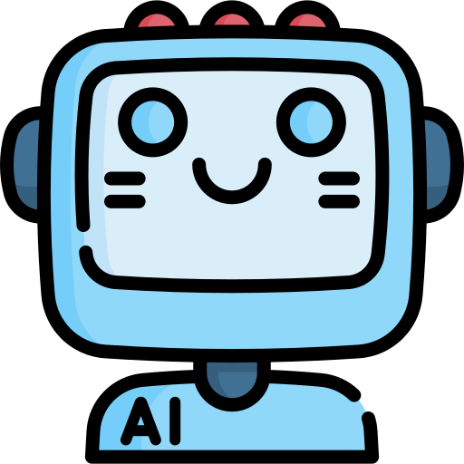

<div align="center">
  

# Buddy
### A proactive agent that notices when you're struggling — before you ask for help.

*Built for Microsoft Agents League · Reasoning Agents Track*
</div>

---

## The Problem

Every productivity app assumes the same thing:

> User has a task → User does the task.

Reality looks like this:

> User has a task → Feels overwhelmed → Avoids it → Feels guilty → Avoids more.

Most apps track the task. **Buddy tracks the human.**

---

## What This Is

Buddy is a proactive accountability agent. It doesn't wait for input — it observes behavior, forms hypotheses about what's blocking someone, retrieves its own behavioral framework to decide how to respond, and initiates the conversation.

The closest reference point isn't a productivity app. It's Baymax: calm, non-judgmental, notices when you're struggling, never shames, never optimizes — just helps you function.

**The LLM is the voice. The agent is the brain. Foundry IQ is the agent's conscience.**

---

## The Agent Loop

```
Observe → Reason → Retrieve → Decide → Act → Learn
```

**Observe** — task behavior, postponement patterns, timing, missed check-ins, user language

**Reason** — three-layer hypothesis engine produces confidence-weighted work states (never a single hard label — humans are messy):
- Layer 1: behavioral signals from the event log
- Layer 2: keyword signals from user messages
- Layer 3: LLM classifier when layers 1 and 2 conflict

**Retrieve** — before deciding anything, Buddy queries its **Foundry IQ knowledge base** for its own framework on the detected state: what this state looks like, what it isn't, and which interventions are designed for it

**Decide** — an LLM call evaluates candidate interventions against the retrieved framework, the hypotheses, and memory of what's worked before — returns a chosen intervention *and a written justification grounded in that framework*

**Act** — a second LLM call generates the actual message. Praise is specific, never generic. Questions are singular. Sometimes the right response is silence and presence, not another question.

**Learn** — memory updates: detected states, interventions used (with recency tracking to force variety), behavioral patterns, work rhythms

---

## Microsoft Foundry IQ — The Agent's Playbook

This is the architectural decision that makes Buddy more than a prompt with good intentions.

Most agent demos store *domain knowledge* in a knowledge base — documentation, FAQs, product manuals. Buddy's Foundry IQ knowledge base stores something different: **Buddy's own behavioral framework.**

11 documents define:

| Category | Documents |
|---|---|
| **State definitions** | avoidance, overwhelm, fatigue, ambiguity, commitment_drift, recovery |
| **Intervention philosophy** | name_the_pattern, surface_smallest_step, celebrate_progress |
| **Core principles** | buddy_philosophy, intervention_selection |

Each state document defines its characteristics and which interventions are *designed* for it. Each intervention document defines its purpose and explicit do's/don'ts — for example, `name_the_pattern` exists to help a user notice avoidance *without shame*, and explicitly rules out guilt or lecturing.

**Before the Decide step runs**, Buddy retrieves the relevant section of this framework for the detected state. The decision LLM then justifies its choice *against that retrieved framework* — not just its own improvisation.

This is visible live in the Agent Brain panel as **"Retrieved from Foundry IQ"** — judges can watch the agent pull its own playbook before acting on it.

> The agent doesn't just decide. It checks its own principles first.

---

## Architecture

```
User Behavior
      │
      ▼
┌─────────────────────────┐
│   State Detection        │  3-layer hypothesis engine
│   Behavioral · Keyword · │  → confidence-weighted states
│   LLM Classification     │
└────────────┬─────────────┘
             ▼
   [overwhelm: 0.60]
   [avoidance: 0.25]
   [fatigue:   0.15]
             │
             ▼
┌─────────────────────────┐
│   Foundry IQ Retrieval   │  ← Buddy's behavioral framework
│   "What does my          │     11 documents: states +
│    framework say about   │     interventions + philosophy
│    this state?"          │
└────────────┬─────────────┘
             ▼
┌─────────────────────────┐
│   Decision Engine (LLM)  │  Evaluates candidates against:
│   → chosen intervention  │  retrieved framework + memory +
│   → written justification│  hypotheses
└────────────┬─────────────┘
             ▼
┌─────────────────────────┐
│   Response Generator     │  LLM as voice, not brain.
│   (LLM)                  │  Tone adapted to state.
└────────────┬─────────────┘
             ▼
┌─────────────────────────┐
│   Memory Layer (SQLite)  │  Event-sourced. Re-injected
│   Patterns · Effective   │  into context every turn —
│   interventions · Rhythm │  no hidden model state.
└─────────────────────────┘
```

**Two distinct LLM calls per turn.** One retrieves a framework and decides what to do. One decides how to say it. Foundry IQ sits between them — the agent's conscience, consulted before action.

---

## What Makes This An Agent (Not A Chatbot)

| Chatbot | Buddy |
|---|---|
| Waits for input | Initiates when a task goes untouched |
| Stateless | Persistent, event-sourced memory across sessions |
| One LLM call → response | Observe → Reason → Retrieve → Decide → Act → Learn |
| Fixed response style | Retrieves its own framework before choosing how to respond |
| Repeats itself | Recent interventions excluded from future choices — enforced variety |
| Generic praise | "You avoided this for three days and came back. That's resilience." |

---

## Key Features

**Proactive check-ins** — agent initiates when tasks go untouched; non-response is treated as data

**Multi-hypothesis reasoning** — confidence-weighted alternatives, not a single diagnosis

**Framework-grounded decisions** — every intervention choice is checked against Buddy's own retrieved playbook (Foundry IQ)

**Adaptive variety** — mechanically prevents repeating the same intervention back-to-back

**Contextual reinforcement** — completion triggers specific, earned celebration — not "great job"

**Full reasoning visibility** — Agent Brain panel shows observations, hypotheses, retrieved framework, chosen intervention, justification, and memory used for every turn

**Work-state boundary** — Buddy detects work states only (avoidance, overwhelm, fatigue, etc.), never mental health states. If signals suggest something beyond work, Buddy steps back honestly rather than overreaching.

---

## Tech Stack

| Layer | Tech |
|---|---|
| Backend | Python, FastAPI |
| Database | SQLite (event-sourced memory) |
| Knowledge Layer | **Microsoft Foundry IQ** (Azure AI Search) |
| LLM | Groq (llama-3.1-8b-instant) |
| Frontend | React, Vite |

---

## Screens

**Task View** — active task, event history, Buddy's opening message already present, "Mark as done" with reinforcement

**Chat** — live conversation with a real-time Agent Brain sidebar updating every turn

**Agent Brain** — full session timeline: every hypothesis, every Foundry IQ retrieval, every intervention and justification, across the entire conversation — watch the agent's reasoning evolve

---

## Future Architecture

This prototype demonstrates the reasoning core. The full product vision:

- **Mobile-first, notification-driven** — Buddy finds you, not the other way around
- **User-created tasks** with due dates; Buddy monitors from creation
- **Live intervention effectiveness tracking** — Buddy learns which strategies work per person over time, written back into Foundry IQ's knowledge base as personalized annotations
- **Multi-agent architecture** — separate state-detection, decision, and delivery agents with defined handoff protocols
- **Weekly/monthly reflections** generated from the event log
- **Expanded Foundry IQ knowledge base** — richer state taxonomy, per-user behavioral notes, recovery pattern library

The architecture decisions here — event-sourced memory, a retrievable behavioral framework, separated reasoning/decision/response layers — aren't placeholders. They're the foundation the full product is built on.

---

## The Vision In One Sentence

> Build the companion you wish existed on the days when starting feels impossible.

---

*Built with Python, FastAPI, React, Groq, and Microsoft Foundry IQ — Agents League 2026, Reasoning Agents Track*
