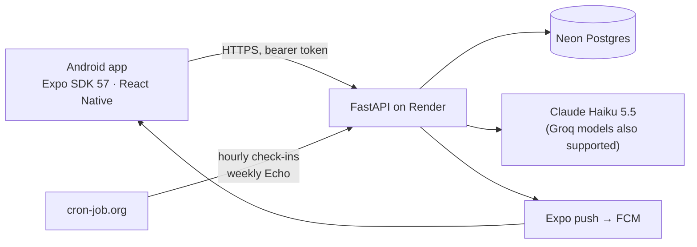

<p align="center">
  
</p>

<h1 align="center">Buddy</h1>

<p align="center">
  <b>A companion that helps you start, by finding out why you're stuck.</b><br>
  Android app (Expo, React Native) · FastAPI backend · Claude Haiku 5.5
</p>

---

Most productivity apps track the task. Buddy tracks the person. When you're avoiding something, Buddy doesn't
tell you to "just start". It finds the real reason you're stuck, helps with that specific reason, and learns
over time what actually works for you.

## How it works

**1. Root cause first.** When a task feels hard, you tap the closest reason, from a check-in notification or
inside the app:

| You tap | What Buddy does |
|---|---|
| Don't know where to start | Asks what "done" looks like, then the part everything depends on, then *your* first step |
| Feels too big | Offers one micro-step ("what about just opening the folder?"), and nothing more |
| Scared it won't be good enough | Checks what the worry really is, then suggests a deliberately rough first version |
| Boring or pointless | Asks whether it needs doing at all, then helps make it lighter. It never moralizes |
| Too tired | Lets you rest. If you still want to work, one move small enough for a tired brain |

**2. Offer, never assign.** Buddy asks before it suggests. If you already have a plan, Buddy backs it exactly as
you said it. If something sounds bigger than work, Buddy steps back honestly and points you to someone you trust.

**3. Proactive.** Buddy checks in on tasks that are due or untouched. The notification names the task and asks
how it's going, in three taps.

**4. Echo: it learns what works for you.** Every week, Echo counts in code, with no model involved, so it can't
invent anything:
- which causes came up
- what you did with each of Buddy's suggestions (took it, brought your own plan, said no)
- whether progress followed within a day

A few developer-approved rules let Buddy adapt once a pattern shows up three or more times. For example, if you
usually bring your own plan, Buddy asks for yours first. Buddy never quotes these numbers back to you.

**5. A kind weekly report.** The Echoes page shows only earned, non-shaming things:
- your wins
- the days you showed up
- one line from Buddy
- what has helped you get going

Last week's report can be saved or shared as text. Ignored check-ins and "days untouched" are never shown.

## Architecture



**Code decides, the model words.** Each conversation framework is a stage machine
(`backend/brain/flow.py`). Every message from the user is read once: cheap patterns first, then a single small
structured-output call. A fixed table then picks the next stage, and the model only writes the reply for that
stage. Every reply passes mechanical checks before it is sent:
- **Hard bans:** therapy phrases, moralizing, invented times.
- **Soft checks:** length, repeated replies, number of questions.

If the model fails, a canned reply goes out instead of an error.

**Built for a free-tier host.**
- No in-process schedulers: cron-job.org calls the `/cron/*` endpoints, which are idempotent.
- LLM calls are async, with timeouts and retries.
- No database session is held while waiting on the model.
- The app's loading screen is honest about the server waking up.

## Tech stack

| | |
|---|---|
| App | Expo SDK 57, React Native, expo-router, Reanimated, react-native-svg, Gaegu + Nunito |
| Backend | Python 3.13, FastAPI, SQLAlchemy 2, Postgres (Neon) / SQLite locally |
| Model | Claude Haiku 5.5 via the Anthropic SDK (structured outputs); Groq's OpenAI-compatible API as an alternative |
| Push | Expo push service with three-button Android notifications |
| Hosting | Render (API), Neon (database), cron-job.org (schedules), EAS (app builds) |

## Repository layout

```
src/                 the app: screens in src/app, the hand-drawn components in src/components
backend/             FastAPI app: auth, tasks, chat, notifications, cron
backend/brain/       conversation engine (flow.py, agent.py), reply checks, Echo, model adapter
backend/brain/buddy_docs/   the playbook: per-cause framework wording, reviewed by the developer
backend/tests/       unit tests (fake model, no network)
testing/             evals against the real model, hand-grading kit, Echo dev report
scripts/             make_icons.py draws the app icon, splash and favicon from Buddy's vector art
```

## Running locally

**Backend**
```bash
cd backend
python3 -m venv venv && venv/bin/pip install -r requirements.txt
venv/bin/uvicorn main:app --reload
```

Environment variables:

| Variable | Purpose |
|---|---|
| `INVITE_CODE` | Required to register |
| `CRON_SECRET` | Protects the `/cron/*` endpoints |
| `GROQ_MODEL` | Picks the model, e.g. `claude-haiku-5-5` |
| `ANTHROPIC_API_KEY` or `GROQ_API_KEY` | Key for the chosen model's provider |
| `DATABASE_URL` | Optional; defaults to a local SQLite file |

**App**
```bash
npm install
npx expo start            # with a development build installed on the phone
```

The app reads `EXPO_PUBLIC_API_URL` and `EXPO_PUBLIC_INVITE_CODE`. New native modules need a new build:
`eas build -p android --profile development`.

## Testing

- **Unit tests:** run `cd backend && venv/bin/python -m pytest -q`. There are 354 tests, covering:
  - per-user data isolation on every table
  - the stage tables, walked through scripted conversations
  - reply checks
  - Echo
  - cron
  - the model adapter
- **Evals** (`testing/`): scripted conversations run through the real app against the real model, then
  hand-graded on seven criteria (see `testing/GRADING.md`).

  | | Old build | This build (Claude Haiku 5.5) |
  |---|---|---|
  | Follows the framework | 25% | **86%** |
  | Warm, natural voice | 14% | **90%** |
  | Keeps the user's own plan | n/a | **18/18** |

## Privacy and safety

- Identity comes only from a server-issued bearer token. Every query is scoped to the caller, and another user's
  data returns 404.
- **Delete my data** wipes everything on the server, including what Echo learned.
- Message content is never logged. Secrets live only in environment variables.
- Buddy works with work states only. It never diagnoses, and it steps back when something sounds bigger than a task.

## What's planned next

- **Google sign-in**, so your data follows you across phones. Today accounts are anonymous, with an invite code.
- **"Talk about my week"**: a short reflection chat with Buddy from the Echoes page.
- **Check-ins shaped by Echo**: timing and wording that match what has helped you before.
- **Per-user time zones** for the Echo week (it currently ends Sunday 23:00 India time for everyone).
- **Exact citations** for every psychology claim in Buddy's playbook, so the advice is checkable.
- **A small fine-tuned model** that holds Buddy's voice, trained only on Buddy's own consented conversations and
  measured against the eval suite.
- **Dark mode** for the hand-drawn theme.
